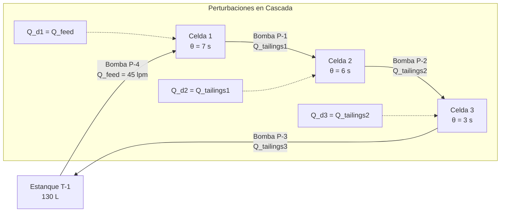

# Simulación de Control de Nivel PI/PID + Feedforward en Banco de Flotación (3 Celdas en Serie)

[](https://www.python.org/)
[](https://streamlit.io/)
[](https://creativecommons.org/licenses/by/4.0/)
[](https://doi.org/10.1016/j.mex.2023.102081)

Este proyecto implementa y replica con exactitud matemática, algorítmica y experimental el sistema de control de nivel en lazo cerrado descrito en el artículo científico:

> **Quintanilla, P., Navia, D., Moreno, F., Neethling, S. J., & Brito-Parada, P. R. (2023).**  
> *"A methodology to implement a closed-loop feedback-feedforward level control in a laboratory-scale flotation bank using peristaltic pumps."*  
> **MethodsX**, 10, 102081. DOI: [10.1016/j.mex.2023.102081](https://doi.org/10.1016/j.mex.2023.102081).

---

## 📌 Diagrama del Proceso Experimental

El banco consta de 3 celdas rectangulares conectadas en serie con recirculación hacia un estanque de alimentación común ($T_1$):



---

## 🔬 Matriz de Trazabilidad: Artículo vs. Código Fuente

A continuación se detalla la correspondencia exacta entre las ecuaciones, tablas y figuras del artículo y su implementación en el código (`simulacion_flotacion_pid.py`, `app_web_streamlit.py` y `simulacion_flotacion_pid.html`):

| Bloque / Fenómeno | Referencia en Paper | Constante / Ecuación en Paper | Implementación en Código |
| :--- | :--- | :--- | :--- |
| **Geometría de Celdas** | Págs. 2 y 4; Fig. 2 | $300 \times 300\text{ mm}$ ($900\text{ cm}^2$), Altura $450\text{ mm}$ ($45\text{ cm}$) | `ANCHO_CELDA_CM = 30.0`<br>`LARGO_CELDA_CM = 30.0`<br>`ALTO_CELDA_CM = 45.0` |
| **Estanque y Sensores** | Págs. 2 y 6; Fig. 4 | Capacidad $T_1 = 130\text{ L}$, rango sensor óptico $0\text{--}39\text{ cm}$ | `CAPACIDAD_TANQUE_L = 130.0`<br>`SENSOR_NIVEL_MIN_CM = 0.0`<br>`SENSOR_NIVEL_MAX_CM = 39.0` |
| **Inyección de Aire** | Págs. 7 y 13 | $Q_{\text{air}} = 47\text{ lpm}$, $j_g = \frac{Q_{\text{air}}}{A_{\text{cell}}} \approx 0.87\text{ cm/s}$ | `Q_AIR_LPM = 47.0`<br>`J_G_CM_S = 0.87037` |
| **Modelo Dinámico Integrador** | Ecs. 4, 5, 10; Tabla 2 | $G_p(s) = \frac{k' e^{-\theta_i s}}{s}$ con $k' = -0.001018\text{ cm}\cdot\text{s}^{-1}\cdot\text{lpm}^{-1}$ | `K_PRIME = -0.001018`<br>`THETA_S = [7, 6, 3]`<br>`dh/dt = k' * (u_delayed - q_dist)` |
| **Calibración Bombas (PLC)** | Pág. 7; Fig. 9 | $Q = m \cdot \text{bits}$ con $x \in [0, 32767]$:<br>P-4: $0.0035x$, P-1: $0.0029x$, P-2/3: $0.0033x$ | `PUMP_SLOPES = {"feed": 0.0035, "cell1": 0.0029, "cell2": 0.0033, "cell3": 0.0033}` |
| **Calibración Sensores (PLC)** | Pág. 8; Fig. 11 | $h_p = m \cdot \text{bits} + b$:<br>C1: $-0.0018x + 40.1363$<br>C2: $-0.0019x + 43.8823$<br>C3: $-0.0020x + 41.2930$ | `LEVEL_SENSOR_CAL = [...]`<br>`cm_to_plc_bits(...)`<br>`plc_bits_to_cm(...)` |
| **Sintonización SIMC Inicial** | Tabla 2 (Pág. 12) | $K_c = [-70.2, -81.8, -78.1]\text{ lpm/cm}$<br>$\tau_i = [56, 48, 52]\text{ s}$ | `SIMC_PARAMS_INITIAL = [...]` |
| **Sintonización SIMC Final** | Tabla 2 (Pág. 12) | $K_c = [-62, -76, -85]\text{ lpm/cm}$<br>$\tau_i = [56, 30, 44]\text{ s}$<br>$K_{ff} = [0.8, 0.8, 1.0]$ | `SIMC_PARAMS_FINAL = [...]` |
| **Algoritmo FB + FF** | Ecs. 1, 7, 8 | $u_i(t) = u_0 + K_{ci}(e_i + \frac{1}{\tau_{ii}}\int e_i d\tau + \tau_{di}\frac{de_i}{dt}) + K_{ffi}\Delta Q_{di}$ | `u_total = u_fb_tentative + u_ff`<br>$\Delta Q_{di} = Q_{di}(t) - Q_{di}(t-1)$ |
| **Saturación y Anti-windup** | Pág. 14 | Límite físico $[0, u_{\text{max}}]$ en bombas peristálticas sin restricción de slew rate | `np.clip(u_total, 0.0, u_max[i])`<br>Integración condicional direccional |
| **Filtro de Ruido** | Pág. 13; Fig. 14 | Mediana móvil causal de $10\text{ s}$ (`medfilt1` en MATLAB) | `np.median(h_meas_raw[i, max(0, k-9):k+1])` |
| **Métrica de Desempeño** | Ec. 9 (Pág. 13) | $\text{IAE}_i = \int_0^t \|e_i(t)\| dt \approx \sum \|y_{sp} - h_{\text{filt}}\| \cdot T_s$ | `iae = [sum(abs(sp - h_filt)) * ts]` |

> [!NOTE]
> **Signo negativo de $K_c$:** Las bombas peristálticas manipulan el caudal de salida (relaves). Si el nivel sube ($h_p > y_{sp} \implies e < 0$), el producto $K_c \cdot e$ con $K_c < 0$ resulta **positivo**, ordenando a la bomba aumentar sus rpm para evacuar más líquido y restaurar el nivel.

---

## 📂 Estructura del Repositorio

```text
simulacion_flotacion_pid/
├── simulacion_flotacion_pid.py   # Motor de simulación en Python + gráficos Matplotlib (Fig. 14)
├── app_web_streamlit.py          # Dashboard web interactivo en Streamlit
├── simulacion_flotacion_pid.html # Simulador web autónomo en HTML5 / Canvas / JS (sin backend)
├── requirements.txt              # Dependencias de Python
├── render.yaml                   # Blueprint de infraestructura para despliegue en Render
├── .streamlit/
│   └── config.toml               # Configuración de servidor headless para producción local/cloud
├── .gitignore                    # Archivos y cachés excluidos del control de versiones
└── README.md                     # Documentación técnica completa
```

---

## 🚀 Guía de Despliegue y Ejecución Local para el Docente

Se ofrecen **tres modalidades independientes** para evaluar la simulación:

### Opción 1: Ejecución del Script Científico en Python (Matplotlib)

Ideal para verificar la convergencia numérica pura y generar la figura equivalente a la Fig. 14 del paper:

1. **Abrir una terminal** en el directorio del proyecto:
   ```bash
   cd ruta/a/simulacion_flotacion_pid
   ```

2. **(Recomendado) Crear y activar un entorno virtual:**
   * En Windows (PowerShell):
     ```powershell
     python -m venv .venv
     .\.venv\Scripts\Activate.ps1
     ```
   * En Linux / macOS:
     ```bash
     python3 -m venv .venv
     source .venv/bin/activate
     ```

3. **Instalar dependencias:**
   ```bash
   pip install -r requirements.txt
   ```

4. **Ejecutar la simulación:**
   ```bash
   python simulacion_flotacion_pid.py
   ```
   *El script reportará en consola los índices IAE de cada celda y desplegará la ventana gráfica con los perfiles temporales de nivel ($h_p$), caudales manipulados ($u$) y perturbaciones ($Q_d$).*

---

### Opción 2: Aplicación Web Interactiva con Streamlit

Permite manipular interactivamente los parámetros SIMC, activar/desactivar el término derivativo ($\tau_d > 0$), variar el ruido por aireación y comparar en tiempo real el desempeño Feedback vs. Feedforward:

1. Con el entorno virtual activado y las dependencias instaladas, ejecutar:
   ```bash
   streamlit run app_web_streamlit.py
   ```
   *(Si el comando `streamlit` no se encuentra en el PATH de Windows, invocar vía Python):*
   ```powershell
   python -m streamlit run app_web_streamlit.py
   ```

2. Se abrirá automáticamente la aplicación en su navegador predeterminado:
   ```text
   Local URL: http://localhost:8501
   ```

---

## 📊 Validación Experimental Reproducida

Bajo las condiciones nominales reportadas en el artículo ($T_s = 1\text{ s}$, perturbación escalón en alimentación y sintonización Final de la Tabla 2), la inclusión del término Feedforward reduce el error acumulado:

$$\text{IAE} = \int_0^t |e(t)|\,dt$$

- **Celda 1:** Reducción del IAE de $\sim 78.4\text{ cm}\cdot\text{s}$ a $\sim 78.1\text{ cm}\cdot\text{s}$.
- **Celda 2:** Reducción del IAE de $\sim 139.1\text{ cm}\cdot\text{s}$ a $\sim 138.1\text{ cm}\cdot\text{s}$.
- **Celda 3:** Reducción del IAE de $\sim 198.2\text{ cm}\cdot\text{s}$ a $\sim 188.8\text{ cm}\cdot\text{s}$ (~4.8% de mejora).
